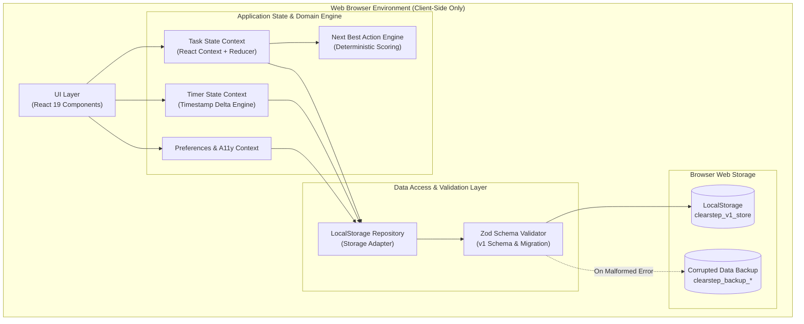

# Architecture Specification — ClearStep

**Product:** ClearStep  
**Document:** `ARCHITECTURE.md`  
**Version:** 1.0.0  
**Status:** Approved  
**Author:** Lead Autonomous Engineering Agent  

---

## 1. System Overview & Boundaries

ClearStep is designed as a **local-first Single Page Application (SPA)** built with React 19, TypeScript, Vite, and Tailwind CSS. The entire application runs client-side in modern web browsers, eliminating backend latency, network dependencies, user account registration barriers, and data privacy vulnerabilities.



---

## 2. Component Architecture

The frontend components follow a modular, atomic structure:

```
src/
├── domain/                    # Pure, framework-agnostic business logic
│   ├── types.ts               # Core domain models & Zod schemas
│   ├── recommendationEngine.ts # Deterministic Next Best Action scoring
│   ├── templates.ts           # Pre-built task breakdown templates
│   └── timerCalculations.ts   # Wall-clock drift-resistant timer math
├── storage/                   # Persistence & repository layer
│   ├── localStorageRepo.ts    # Safe typed repository with schema validation
│   └── seedData.ts            # Realistic starter data for first-time use
├── context/                   # React State Contexts
│   ├── TaskContext.tsx        # Tasks, subtasks, filtering, sorting
│   ├── TimerContext.tsx       # Focus sessions, timer states, background sync
│   └── PreferencesContext.tsx # User theme, timer durations, accessibility
├── components/                # UI Presentation Components
│   ├── common/                # Primitives (Button, Modal, Badge, ProgressBar)
│   ├── layout/                # Header, Navigation, Footer, Container
│   ├── tasks/                 # TaskCard, TaskList, TaskModal, BreakdownView
│   ├── nextAction/            # NextActionHero card with rationale display
│   ├── focus/                 # FocusModeOverlay, TimerClock, SessionComplete
│   ├── progress/              # StatsOverview, ActivityChart, SessionLog
│   └── settings/              # PreferencesPanel, BackupRestoreModal
├── App.tsx                    # Top-level router & global shortcut listener
└── main.tsx                   # React root entry point
```

---

## 3. State Management & Data Flow

ClearStep avoids heavy external state libraries (Redux, Zustand) in favor of **specialized React Contexts with Reducers and pure domain functions**:

1. **Unidirectional Data Flow:** User actions dispatch typed domain events (`ADD_TASK`, `TOGGLE_SUBTASK`, `SET_FOCUS_TASK`, `START_TIMER`).
2. **Deterministic Recommendation Pipeline:**
   - Every state update triggers the pure function `calculateNextBestAction(tasks)`.
   - The engine scores each active task based on:
     - Focus flag ($+100$)
     - Overdue status ($+60$)
     - Due today status ($+40$)
     - Due within 48h ($+20$)
     - Priority tier ($+30$ urgent down to $+0$ low)
     - Existing subtask momentum ($+10$)
   - Computes both the highest-scoring `taskId` and an explainable `rationale` string.
3. **Background-Resilient Timer State:**
   - Instead of relying on vulnerable `setInterval` ticks (which browsers heavily throttle in background tabs), the timer stores:
     - `targetSeconds`
     - `startTime` (timestamp)
     - `pausedRemainingSeconds`
     - `isRunning` (boolean)
   - On every frame or tick, `remaining = startTime + targetDuration - Date.now()`.
   - Even if the tab is inactive for 20 minutes or the computer sleeps, resuming calculates the exact actual elapsed time.

---

## 4. Persistence Architecture & Recovery Protocol

1. **Storage Schema:**
   All application state is serialized under a single versioned key: `clearstep_v1_store`.
2. **Schema Enforcement via Zod:**
   - On startup, `localStorage.getItem("clearstep_v1_store")` is read and parsed through `AppStorageSchema.safeParse()`.
   - If the parse succeeds, the validated state initializes the app.
   - If the read yields `null` (first time launch), default sample data is seeded.
3. **Corruption Recovery & Safety Net:**
   - If `safeParse()` fails (due to manual tampering, storage corruption, or breaking schema drift):
     1. The raw unparseable string is archived to `clearstep_backup_<timestamp>` so no user data is lost.
     2. A clean, valid default state is instantiated.
     3. A user-friendly non-blocking notification is surfaced informing the user that corrupted data was safely archived and reset.

---

## 5. Security & Privacy Guarantees

- **No Remote Data Exfiltration:** The application makes zero outgoing network calls. 100% of user data remains on the local device.
- **XSS Prevention:** React's default JSX string escaping prevents script injection. No `dangerouslySetInnerHTML` is used.
- **No Secrets in Bundles:** No API keys, credentials, or third-party SDK tokens are bundled in the client distribution.
- **Safe JSON Import:** User-uploaded backup files are validated through the Zod schema before state application.

---

## 6. Architectural Trade-offs & Decisions

| Decision | Pros | Cons / Mitigations |
|----------|------|--------------------|
| **Local-First (LocalStorage)** | Instant load, 100% offline, zero latency, maximum privacy | Limited to ~5MB per domain; mitigated by lightweight JSON schema and export/import functionality. |
| **Deterministic Scoring vs AI LLM** | 100% reliable, zero token cost, zero latency, predictable explanations | Lacks conversational open-ended dialogue; mitigated by structured task breakdown templates. |
| **React Context vs External State** | Zero bundle bloat, native React 19 concurrent features | Requires careful context splitting (`TaskContext`, `TimerContext`) to prevent unnecessary re-renders. |
| **Tailwind CSS Utility Design Tokens** | Rapid UI development, tiny final CSS bundle, easy dark mode and reduced-motion toggling | Class names in markup; mitigated by extracting reusable component primitives. |

---
*End of ARCHITECTURE.md*
