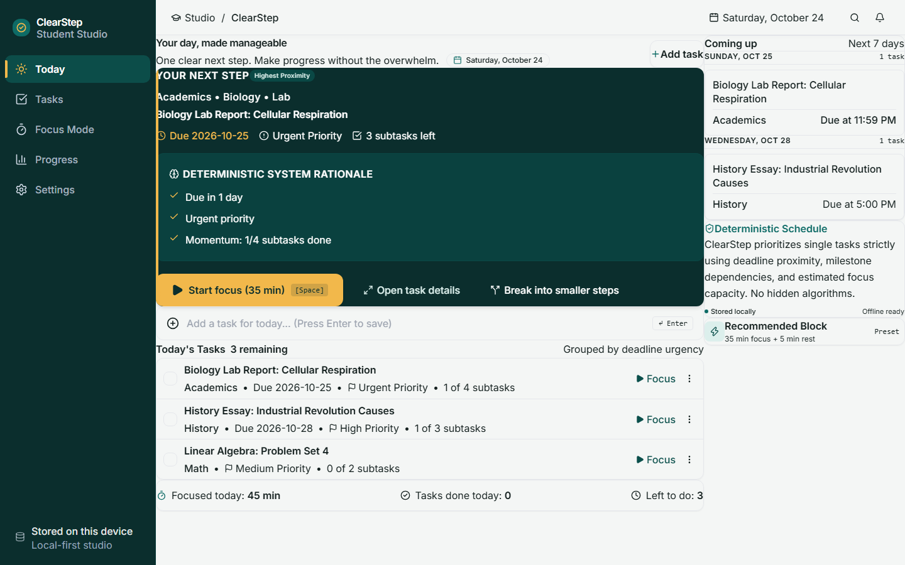
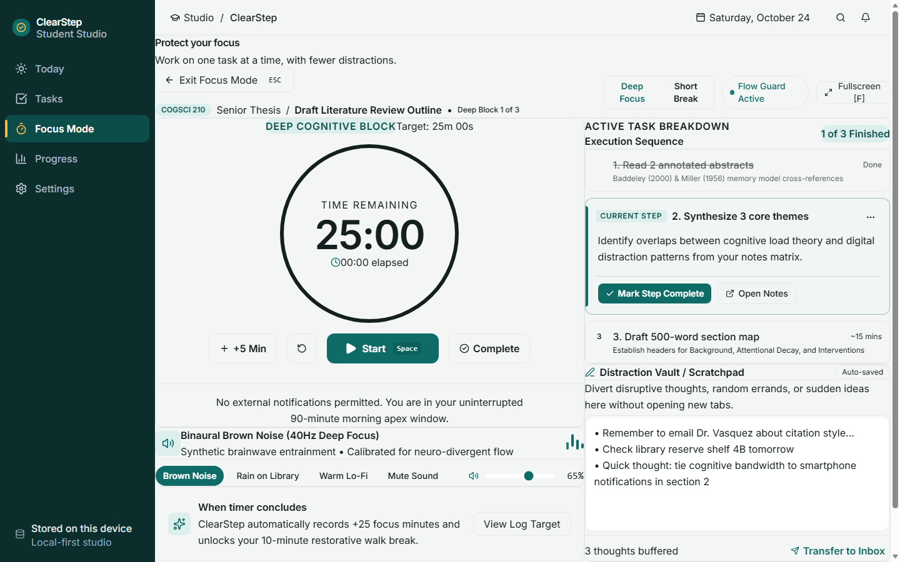
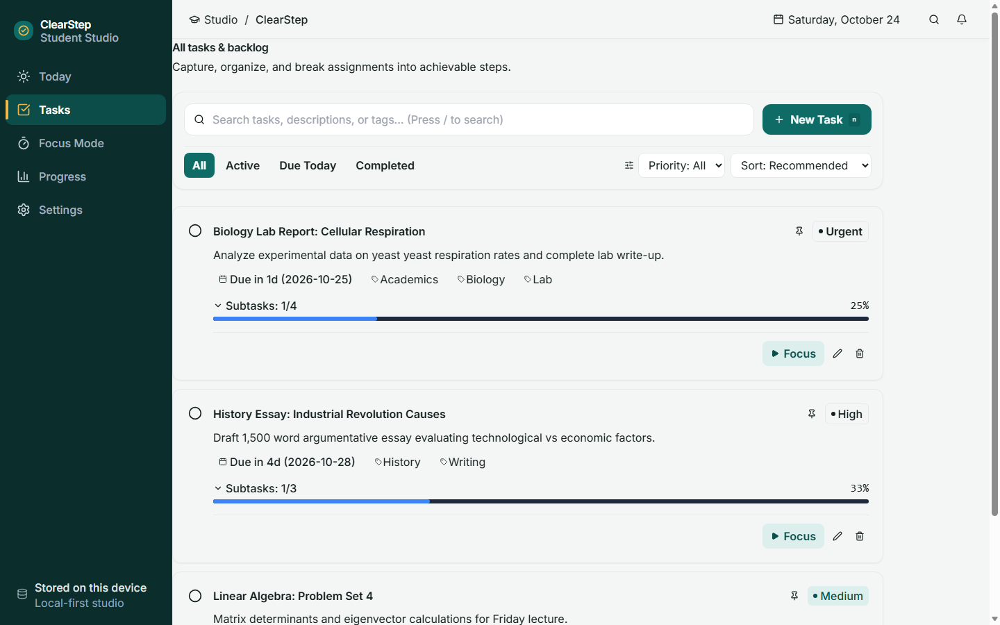
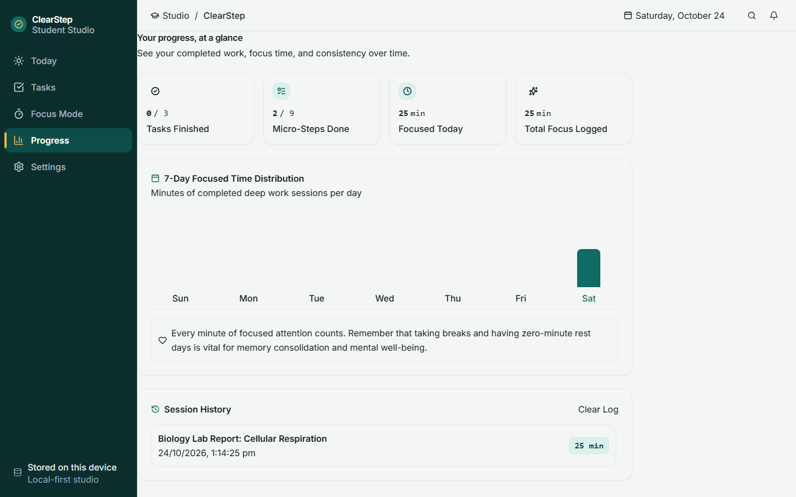

# ClearStep — Less overwhelm. One clear next step.

> **Taskforge Hackathon Submission**  
> An accessible, local-first web application engineered to conquer task paralysis and cognitive overwhelm for students.
>
> **Live Demo:** [https://github.com/vishu2212/ClearStep](https://github.com/vishu2212/ClearStep) *(Deployment target)*<br />
> **Repository:** [https://github.com/vishu2212/ClearStep.git](https://github.com/vishu2212/ClearStep.git)

---

## Visual Preview

| Today Dashboard | Focus Mode View |
| :---: | :---: |
|  |  |

| Task Workspace & Breakdown | Weekly Progress & Stats |
| :---: | :---: |
|  |  |

---

## 1. Problem & Core Workflow

Students and neurodivergent individuals face a recurring, paralyzing barrier: **executive dysfunction and backlog overload**. Standard task managers function as bottomless accumulation pits, displaying dozens of competing assignments simultaneously. This flood of pending items forces the user to expend precious mental energy just deciding what to work on, frequently triggering procrastination or complete avoidance.

**ClearStep reverses this dynamic with a simple, three-step calm workflow:**

```
+-------------------------------------------------------------------------+
| 1. DECONSTRUCT                                                          |
| Break large, intimidating assignments into 10-15 min micro-steps        |
| using 1-click templates (Research Paper, Exam Prep, Software, Admin).   |
+-------------------------------------------------------------------------+
                                    |
                                    v
+-------------------------------------------------------------------------+
| 2. RECOMMENDED NEXT BEST ACTION                                         |
| Transparent deterministic scoring selects the SINGLE highest-impact     |
| task to work on right now, explaining why in plain language.            |
+-------------------------------------------------------------------------+
                                    |
                                    v
+-------------------------------------------------------------------------+
| 3. CALM FOCUS SESSION                                                   |
| Backlog hides away. Run an inactivity-resilient focus timer with        |
| ambient audio, distraction note capture, and zero guilt streaks.        |
+-------------------------------------------------------------------------+
```

---

## 2. Transparent Next Best Action Engine

ClearStep does **not** rely on opaque black-box machine learning or hallucinated suggestions. The Next Best Action algorithm is 100% deterministic, reproducible, and explainable.

### Scoring Heuristics & Weights

| Signal | Weight | Rationale |
| :--- | :---: | :--- |
| **Manual Focus Pin** | `+100` | **User Intent Sovereignty:** If a student intentionally chooses a task to focus on, human agency is absolute. Automated heuristics never override intentional user choice. |
| **Overdue Task** | `+60` | Mitigates missed deadlines and immediate academic risk. |
| **Due Today** | `+40` | Directs focus to today's scheduled commitments. |
| **Due Soon (<= 2 days)**| `+20` | Gentle preemptive awareness before deadlines turn urgent. |
| **Priority: Urgent** | `+30` | Explicit instructor or syllabus importance. |
| **Priority: High** | `+20` | Significant academic assignment or milestone. |
| **Priority: Medium** | `+10` | Standard recurring coursework. |
| **Subtask Momentum** | `+10` | Rewards partially completed subtasks (e.g. 1/3 or 2/4 done) to leverage the psychological Zeigarnik effect. |
| **Age Bonus** | `+0` to `+5` | Gradual bonus (+1 per week, capped at 5) to prevent stagnant backlog tasks from being forgotten. |

### Strict Deterministic Tie-Breaking
When two tasks achieve an identical composite score:
1. **Age Preference:** The older task (`createdAt` earlier in time) is selected first to prevent starvation.
2. **Deterministic Fallback:** If `createdAt` timestamps are identical, tie-breaking falls back to alphabetical order of task IDs (`task.id.localeCompare(other.id) < 0`).
3. **Reproducibility:** When evaluated with a fixed reference date (`todayStr`), the recommendation is pure and identical across all calls regardless of input array ordering.

---

## 3. Core Features

- **Next Best Action Hero Card:** Highlights the immediate next step with a plain-English explanation (e.g., *"Why now: Due today • Urgent priority • Momentum: 2/3 subtasks done"*).
- **Subtask Decomposition & Quick Templates:** 1-click step breakdowns for:
  - **Literature / Research Paper:** Find 3 papers -> Outline sections -> Draft thesis statement -> Write methodology -> Polish citations.
  - **Exam Preparation:** Review syllabus checklist -> Create formula sheet -> Complete practice problems -> Teach concept to peer.
  - **Project Milestone:** Define acceptance criteria -> Scaffold component architecture -> Implement unit tests -> Verify in browser.
  - **Administrative Task:** Gather required documentation -> Fill initial fields -> Proofread submission -> Submit & file receipt.
- **Inactivity-Resilient Focus Timer:** Wall-clock delta calculations (`calculateRemainingSeconds(startTime, pausedRemaining, Date.now())`) guarantee that timer countdowns never drift or pause when browser tabs sleep or get throttled in the background.
- **Distraction Vault / Scratchpad:** Quick in-session scratchpad to capture intrusive thoughts without derailing deep focus, with a 1-click "Transfer to Inbox" action.
- **Ambient Audio Synthesizer:** Pure Web Audio API synthesized soundscapes (Binaural Brown Noise, White Noise, Pink Noise, Rain Simulation) with zero external audio assets.
- **7-Day Progress Log:** Effort tracking focused on cognitive blocks completed and micro-steps finished—with zero guilt mechanics, broken streak punishments, or manipulative badges.

---

## 4. Privacy, Data Storage & Offline Architecture

- **Local-First & Zero Backend:** ClearStep operates 100% in the client browser. No user accounts, no passwords, no telemetry tracking, and zero remote database connections.
- **Browser-Scoped Unencrypted Storage:** All tasks, subtasks, timer sessions, and preferences are stored in the browser's `localStorage` (`clearstep_v1_store`).
  > **Note on Security:** Data stored in `localStorage` is unencrypted and accessible to anyone with physical access or administrative privileges to the local operating system user profile.
- **Clearing Local Data:**
  - In-app: Go to **Settings** -> **Danger Zone** -> **"Reset All Data"**.
  - Browser: Open DevTools Console and execute `localStorage.clear()`, or clear site data for the host in browser settings.
- **External Network Assets:** Typography (Inter, Manrope, Plus Jakarta Sans) is served from Google Fonts CDN for visual fidelity. If offline on initial page load, standard system sans-serif font stacks are used automatically as fallbacks.
- **Fault-Tolerant Schema Recovery:** All storage reads are validated through strict Zod schemas. If corrupted data is encountered, ClearStep snapshots the raw data to a backup slot (`clearstep_backup_<timestamp>`) and initializes defaults without crashing the React root.

---

## 5. Accessibility Measures & Design Decisions

ClearStep incorporates intentional accessibility features for students with ADHD, visual fatigue, or motor sensitivities:

1. **Color Contrast & Readability:** Text and primary interactive surfaces meet or exceed a 4.5:1 contrast ratio against light (`#F8FAFC`) and dark (`#090D16`) surfaces.
2. **Visible Focus Rings:** Every button, tab, input, and modal has explicit, high-visibility double-ring focus states (`focus-visible:ring-2 focus-visible:ring-brand`).
3. **Motion Sensitivity:** Respects operating system `prefers-reduced-motion` settings and provides an in-app toggle to instantly disable CSS transitions and animations.
4. **Semantic HTML & Screen Reader Landmarks:** Built with semantic `<header>`, `<nav>`, `<main>`, and `<section>` landmarks, modal dialog semantics with `aria-modal="true"`, and polite live regions (`aria-live="polite"`).
5. **Keyboard Shortcuts:**
   - `/` — Focus search input
   - `n` — Create new task
   - `f` — Jump to Focus Mode
   - `Space` — Start / Pause focus timer
   - `Esc` — Close dialogs or exit full views

---

## 6. Quick Setup & Development

### Prerequisites
- Node.js v18+ (tested on Node.js v24+)
- npm 9+ (tested on npm 11+)

### Installation & Run

```bash
# 1. Clone the repository
git clone https://github.com/vishu2212/ClearStep.git
cd ClearStep

# 2. Install dependencies
npm install

# 3. Start development server
npm run dev
```

Visit `http://localhost:5173` in any modern web browser.

---

## 7. Verification & Quality Gates

Run the automated verification suite before submitting changes:

```bash
# 1. Run unit and integration tests (Vitest)
npm run test

# 2. Strict TypeScript typecheck (zero implicit any)
npx tsc --noEmit

# 3. Production build validation (Vite)
npm run build
```

### Verified Test Suites
- `src/test/recommendationEngine.test.ts`: Pure scoring weights, due-date urgency, User Intent Sovereignty, subtask momentum, deterministic tie-breakers, and invalid date safety.
- `src/test/TimerContextAttribution.test.tsx`: Independent vs task-linked session attribution, mode switching resets, and wall-clock `addSeconds` synchronization.
- `src/test/timerCalculations.test.ts`: Wall-clock delta math, background tab sleep immunity, MM:SS formatting, and percentage math.
- `src/test/localStorageRepo.test.ts`: Zod schema validation, quota exceeded error handling, security policy error recovery, corrupted data backup preservation, and JSON import/export.
- `src/test/FocusModeInteractions.test.tsx`: Timer controls, +5 min increments, Distraction Vault note transfers, and session completion modal.
- `src/test/App.test.tsx`: Component integration, navigation tabs, search and filtering, and accessible modal lifecycles.

---

## 8. Architecture & Repository Structure

```
src/
├── domain/                    # Pure TypeScript business logic (zero React dependencies)
│   ├── types.ts               # Zod schemas and TypeScript domain contracts
│   ├── recommendationEngine.ts# Deterministic Next Best Action scoring algorithm
│   ├── templates.ts           # Pre-built academic micro-step templates
│   └── timerCalculations.ts   # Wall-clock drift-resistant timer math
├── storage/                   # Local-first persistence
│   ├── localStorageRepo.ts    # Zod-validated storage with typed error reporting
│   └── seedData.ts            # Default starter student tasks
├── context/                   # React Context Providers & State
│   ├── TaskContext.tsx        # Tasks, filtering, sorting, and persistence status
│   ├── TimerContext.tsx       # Focus sessions, mode transitions, and attribution
│   └── PreferencesContext.tsx # User theme, timer durations, accessibility
├── components/                # UI Components structured by feature domain
│   ├── common/                # Button, Modal, Badge, ProgressBar
│   ├── layout/                # Navbar, CorruptionAlert, ContextualSidePanel
│   ├── nextAction/            # NextActionHero card
│   ├── tasks/                 # TaskCard, TodayTaskRow, TaskFilterBar, TaskModal
│   ├── focus/                 # FocusModeView
│   ├── progress/              # ProgressView (Stats & 7-Day History)
│   └── settings/              # SettingsView (Preferences, Backup, Reset)
├── App.tsx                    # Main layout coordinator & keyboard listeners
└── main.tsx                   # React root entry point
```

### In-Depth Architectural Documentation
- [`PRD.md`](./PRD.md) — Product Requirements & User Scenarios
- [`DESIGN.md`](./DESIGN.md) — Visual Design System & Component Tokens
- [`ARCHITECTURE.md`](./ARCHITECTURE.md) — System Boundaries & State Architecture
- [`DATABASE.md`](./DATABASE.md) — Storage Schemas & Recovery Protocols
- [`API.md`](./API.md) — Internal Application Domain Interfaces
- [`AGENTS.md`](./AGENTS.md) — Agent Operating Standards & Definition of Done

---

## 9. License & Attribution

ClearStep is open-source software licensed under the [MIT License](./LICENSE).
